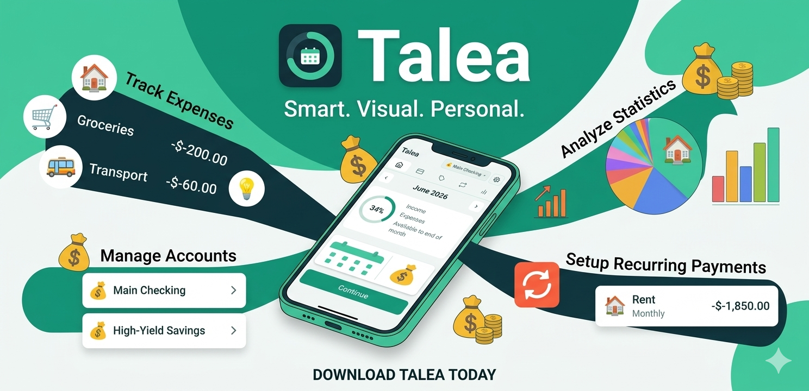

# Talea

<p align="center">
  
</p>

A **local-first, cross-platform budget app**. Your money data lives on your
device in a local SQLite database — no account, no cloud, no sync server in the
loop. Talea targets **Android and iOS**, with the desktop build used for
day-to-day development.

> **Status:** actively developed and in testing (iOS via TestFlight, Android).
> See [`CHANGELOG.md`](CHANGELOG.md) for the release history.

## What it does

- **Monthly cashflow ledger with carry-over** — for the selected month: income,
  expenses, and *available to end of month*; a surplus or overspend carries into
  the next month, per account. Swipe between months. In the current month,
  **balance today** shows what your bank should say right now, so a forgotten
  entry stands out.
- **Accounts** with a fixed currency and opening balance — plus **summary
  accounts**, a read-only type that combines several same-currency accounts into
  one overview (combined budget, merged entry list and stats, widget target).
- **Entries** (income/expense, optional note + category) with full CRUD, and
  same-currency account-to-account transfers.
- **Categories** — a global, descriptive list (emoji / preset icons).
- **Recurring rules** — weekly / monthly / yearly + every-N, with effective-dated
  amounts and single-occurrence skip or edit.
- **Category budgets** — a planned monthly amount per category that is held back
  from what's free to spend, and consumed by your actual purchases in it rather
  than added on top, with effective-dated amounts so a raise doesn't rewrite past
  months. Not envelopes: nothing is refused for going over, and an unspent budget
  just carries over as ordinary surplus.
- **Statistics** — per-month expenses broken down by category.
- **Budget ring + home-screen widget** — an abstract health ring on Android & iOS;
  the actual figures stay in-app.
- **Optional biometric app lock** (mobile).
- **Backup & restore** to your own Nextcloud over WebDAV (optional, manual).
- **12 languages**, auto-detected from the device and switchable in Settings.

## Why "local-first"

- The database is the source of truth and it sits on the device.
- The app is fully functional offline.
- Sensitive figures stay on-device, optionally behind a biometric lock.

## Architecture

Talea is a **Cargo workspace** with a strict separation between pure domain
logic and the platform shell:

```
talea/
├── core/        → pure-Rust domain + money math. No Tauri, no IO, no SQL.
│                  Fully unit-tested. The "what the app means" layer.
├── src-tauri/   → the Tauri shell. Bridges `core` to the frontend via
│                  commands, owns persistence (SQLite via sqlx) and platform
│                  integration. The "how it runs on a device" layer.
└── frontend/    → React + TypeScript (Vite). The UI. Talks to the shell
                   only through Tauri's typed `invoke` boundary.
```

The dependency direction is one-way and enforced by crate boundaries:

```
frontend ──invoke──▶ src-tauri ──calls──▶ core
                         │
                         └── sqlx ──▶ SQLite (on device)
```

`core` knows nothing about Tauri, the filesystem, or SQL — the budgeting rules
and money arithmetic stay testable in isolation and portable if the shell ever
changes. The full rationale, the budgeting model, and the schema live in
[`docs/DESIGN.md`](docs/DESIGN.md).

## Prerequisites

- Rust (stable, ≥ 1.99) with `cargo`.
- Node.js 20.19+ or 22.12+ (what Vite 8 needs) and npm.
- Tauri 2 system dependencies for your platform — see the
  [Tauri prerequisites](https://v2.tauri.app/start/prerequisites/).

## Getting started

```bash
# Install frontend dependencies
npm --prefix frontend install

# Run the desktop dev build (starts Vite, then the Tauri shell)
cargo tauri dev

# Production build
cargo tauri build
```

## Documentation

- **Product model & design decisions** → [`docs/DESIGN.md`](docs/DESIGN.md)
- **Building, on-device testing, signing & release, troubleshooting**, plus the
  quality gates, the `sqlx` offline cache, and how to reset local data →
  [`docs/DEVELOPMENT.md`](docs/DEVELOPMENT.md)
- **Release history** → [`CHANGELOG.md`](CHANGELOG.md)

## License

MIT.
